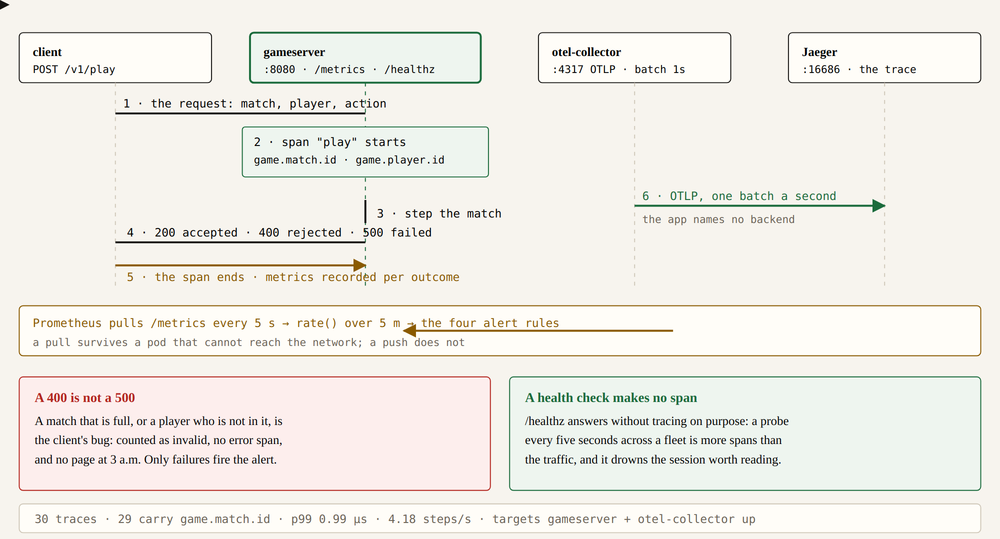

# otel-game-observability

[](https://github.com/lasttoss/otel-game-observability/actions/workflows/ci.yml)

A game backend small enough to read in one sitting, instrumented the way a real one has to be, with the
stack that reads it — collector, Jaeger, Prometheus, Grafana — in one `make up`.

The claim this repository makes is specific and is checked against the running stack, not asserted here:

The panels this stack is supposed to answer an incident with are written down in [`docs/incident-metrics.md`](docs/incident-metrics.md) — including a connection count that must be flat and a cgroup reading that a node graph cannot show.

> **Every step of a match is one span, and that span carries the match, the player and the action, so that a
> question like "which match was slow" has an answer in a trace instead of a log grep.**

Measured on the running stack (`make up && make demo && make traces`):

```
30 traces | 29 carry game.match.id | 2 error spans
tags of one served step: {game.action: move, game.match.id: m-1, game.match.step: 5,
                          game.match.players: 4, game.player.id: p-1}
p99 of a match step: 0.99 us        steps served: 4.18/s
Prometheus targets: gameserver up, otel-collector up
Grafana: datasources [Jaeger, Prometheus], dashboard "Game server" provisioned
```

## Quick start

```bash
make up      # collector, Jaeger, Prometheus, Grafana and the game server
make demo    # three matches of four players, some steps, and one payload a client got wrong
make traces  # the same query a person would run in the Jaeger UI
make down
```

| Where | Port | What to look at |
|---|---|---|
| Game server | `18081` → `:8080` | `POST /v1/play`, `GET /healthz`, `GET /metrics` |
| Jaeger | `16686` | a play session as a trace |
| Prometheus | `9090` | the scrape targets and the four alert rules |
| Grafana | `13000` | dashboard **Game server** |

The ports were picked free on the machine this was written on and are worth changing if something else
already owns one: a stack that will not start is a stack that does not get read.

## What is in here, and why

| File | The decision it records |
|---|---|
| `gameserver.go` | One span per step, named for the step; metrics named for the question, not for the code |
| `cmd/gameserver/main.go` | Traces out over OTLP, metrics exposed for Prometheus to **pull**; runs without a collector |
| `infra/otel-collector.yaml` | OTLP in, batch 1s, OTLP out to Jaeger — the backend is a config change, not a redeploy |
| `infra/prometheus/rules.yml` | Alerts as code, in the repository, because an alert in a UI is an alert nobody reviews |
| `infra/grafana/` | Datasources and dashboards as code, so the same JSON works on a laptop and in production |
| `docker-compose.yml` | The whole story in one command, with pinned image versions |

The distinction the code is deliberate about: a step the **game refuses** (a match that is full, a player who
is not in it) is a `400` counted as `invalid`, while a step that **failed** is a `500`, an error span and
counted as `failed`. A dashboard that adds those two together pages somebody at three in the morning for a
client's bug. `infra/prometheus/rules.yml` fires on `failed` only.

## Three things found by running it, not by reasoning about it

1. **A collector's own metrics are bound to localhost by default.** The `otel-collector:8888` scrape job was
   `down` forever, which would have made an `up == 0` alert fire permanently — an alert that is always red is
   an alert nobody reads. Fixed by binding the pull reader to `0.0.0.0` in the collector's `telemetry` block.
2. **A mounted config file does not reload a container.** Editing `infra/otel-collector.yaml` and re-running
   `docker compose up -d` left the old config running (the file is mounted, so compose sees no change):
   `docker compose up -d --force-recreate otel-collector`.
3. **`p99` reads `NaN` for about a minute after a restart.** A restarted process resets its counters, and
   `rate()` over a window that spans a reset is zero, so every histogram bucket is zero and
   `histogram_quantile` has nothing to interpolate. It heals as samples accumulate; a dashboard that shows
   `NaN` on a fresh deploy is not broken, it is young.

4. **The first run of this repository's CI failed on a stack that was working.** The job asked Jaeger once,
   immediately after the last request, and the honest answer at that moment is "nothing yet": the collector
   batches for a second, Jaeger indexes a second after that, Prometheus needs a scrape. Telemetry is
   eventually consistent, so the job now retries — an assertion with no tolerance for lag is an assertion
   that measures the runner.

## Tests

The telemetry goes through providers rather than being created inline — that is the whole reason the tests
can assert what the service recorded instead of what somebody hoped:

```bash
make test    # go test -race ./...
make check   # gofmt, vet, tests, promtool check rules, docker compose config
```

Eight tests, including one that a health check makes **no span at all** (a probe every five seconds would
drown the traces), one that the counters agree with the spans, and one that a rejected request still keeps
the match id on its span — which is how the second finding above was caught.

## What this is not

Not a product and not a benchmark. There is no sampling configuration beyond the collector's defaults, no
tail-based sampling, no SLO burn-rate alerts, and no Kubernetes manifests — those are
[`k8s-game-server-charts`](https://github.com/lasttoss/k8s-game-server-charts). The game logic is a
`matchStore` with a mutex, in `cmd/gameserver/main.go`, and it is there to be replaced.

## One step, in sequence



**Figure 1.** One step of one match, and where it goes

`docs/figures/one-step-sequence.html` draws the path behind the numbers in this README: a request makes a
span that carries the match, the player and the action; the span leaves over OTLP to a collector that
batches it into Jaeger; and the same request has already been counted in metrics that Prometheus pulls
every five seconds, which is what the four alert rules are computed from.

`make diagram` exports a PNG if a browser is
present — the sources are what gets reviewed, the image is a build artifact.

## Repository standard

Six items, applied where they mean something rather than everywhere. The exclusions are the point of
the table: an item that cannot be honest in a repository of this kind is left out and said so.

| Item | Here |
|---|---|
| `docker-compose.yml` | ✓ `docker-compose.yml` |
| `Dockerfile` | ✓ `Dockerfile` |
| Helm chart | not applicable - the five containers are a demo stack run by compose; charting the app alone would drop the collector, Jaeger, Prometheus and Grafana that this repository exists to show |
| Diagram | ✓ `docs/figures/one-step-sequence.html` plus the exported PNG the README embeds |
| Tests, run in CI | ✓ check the alert rules, check the compose file, bring the stack up, play a session |
| CI + `Makefile` | ✓ `.github/workflows/ci.yml` and `Makefile` |
